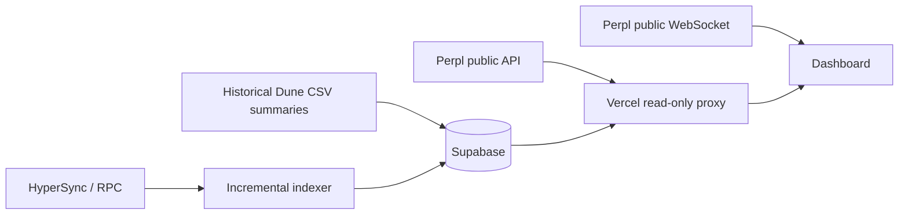
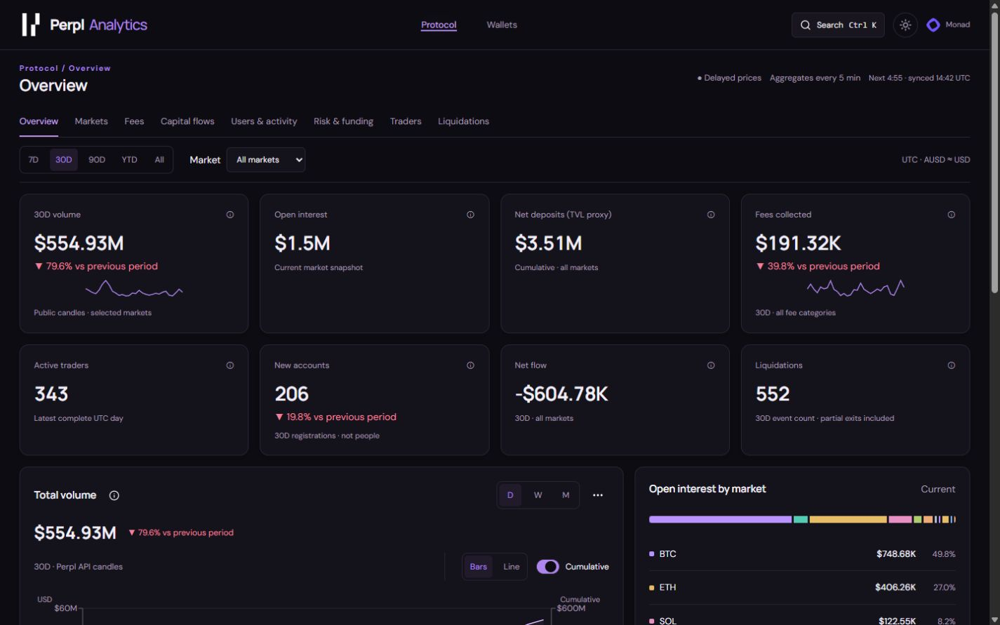

# Perpl Analytics

Protocol analytics and public wallet intelligence for Perpl on Monad. React and TypeScript frontend with a Node.js data service.

## Current capabilities

- Protocol volume, open interest, capital flows, fees, account growth, market and funding views.
- Daily, weekly and monthly charts, with an optional cumulative line.
- Public address lookup for current margin and positions, plus Perpl leaderboard performance.
- Dark and light themes; responsive layouts.
- Historical Dune CSV summaries, extended by HyperSync/RPC. No recurring Dune API queries.
- Five-minute refresh targets with visible source timestamps and stale-data status.

History begins in February 2026. Historical summary coverage and liquidation detail coverage differ; the UI reports partial coverage rather than treating missing rows as zero.

## Run locally

Use Node.js 24 (minimum 22.13):

```sh
npm ci
npm run dev:local
```

The launcher prints and opens a verified localhost URL. Its process must stay open. Server secrets belong in a local `.env`, which is excluded from Git. A new checkout does not contain the installed computer's databases or imported summaries. The original computer retains those files.

## Hosting status

The dashboard is deployed at https://perpl-analytics.vercel.app on Vercel Hobby. Supabase Free PostgreSQL retains the historical summaries and checkpoints. A protected refresh endpoint is called every five minutes by Supabase Cron, with credentials in Vault. Live protocol, market and wallet routes have been verified. See the deployment guide for operational checks and limits.

See [DEPLOYMENT.md](DEPLOYMENT.md) for the deployment order and required configuration. Vercel builds intentionally refuse to publish without backend configuration.

## Validation

```sh
node scripts/build-web.mjs
node tests/web-proxy.mjs
npm run test:cloud
npx tsc --noEmit
```

## Project layout

- `components/`, `hooks/`, `lib/`: dashboard and data presentation.
- `indexer/`: decoding, current wallet reads, aggregate storage and incremental indexing.
- `cloud/`: PostgreSQL backend, authenticated refresh job and checksummed historical seed.
- `scripts/local-dashboard.mjs`: installed local server.
- `scripts/build-web.mjs`, `api/proxy.mjs`, `vercel.json`: Vercel frontend deployment.
- `tests/`: data integrity and dashboard verification.
- `docs/local-development-history.md`: earlier implementation notes; some sections describe superseded functionality.

No credentials or local database files are included. The compact cloud seed includes public blockchain aggregates and event details, without wallet-search caches. Wallet connections and user API keys are not required for public wallet reads. Monetary values assume AUSD equals one USD; liquidation prices are estimates.

## Free-tier protections

Public responses share Vercel CDN caching for up to five minutes. Visible dashboards fetch protocol summaries on the five-minute sync event; hidden dashboards stop polling. Disposable API caches have an 8 MiB serialized-data budget, a 512-entry limit and a 1 MiB per-entry limit. Candle windows replace older cached snapshots. PostgreSQL overhead is additional. Cache writes and indexing batches share a storage guard, capped at 400 MiB. At the guard, indexing pauses without advancing its checkpoint and public API reads can return fresh uncached data. Existing historical tables are never pruned by cache maintenance. Unused temporary trading-transaction hashes are no longer collected; old hashes expire under their existing two-day policy.

These safeguards reduce usage; they do not guarantee unlimited traffic within provider quotas.


## Analytics release

Perpl Analytics brings public protocol totals, market risk and wallet positions into one shareable view. Charts use one consistent set of range, bucket, legend and export controls. The public WebSocket client is included, but Perpl currently rejects our website Origin with HTTP 403. Until the provider allows this domain or a relay is provisioned, prices safely use the five-minute snapshots. Account state and indexed summaries retain the five-minute refresh. Metrics distinguish recorded facts, live mark estimates and incomplete history.



- Charts: D/W/M buckets, 7D/30D/90D/YTD/All ranges, CSV/PNG/table export, URL state and partial-bucket labels.
- Activity: distinct account DAU/WAU/MAU, first-recorded-fill cohorts and fill concentration. These count trading accounts, not people.
- Wallets: public positions, mark-adjusted unrealized PnL estimates, browser-local watchlist and up to three-wallet comparison. Saved wallet lists never require an account or private key.
- Fees: total fill fees already include builder share in the Perpl SDK. Builder is shown separately as a component, not added twice.
- Methodology and metric definitions: [/methodology](https://perpl-analytics.vercel.app/methodology).

### Additional storage and explicit deferrals

| Dataset | Estimated growth / bound | Policy |
|---|---|---|
| Market state snapshots | About 8,640 rows/month for 12 markets, approximately 8–16 MiB/month including indexes | Hourly upsert; 90-day rolling retention; shared 400 MiB guard |
| Recent flow details | At most 1,000 records, roughly 1 MiB plus indexes | Seven days or latest 1,000; original permanent daily totals remain |
| Activity/cohort response | Measured ~73 KB on full historical seed | Existing five-minute bounded API cache; no new permanent aggregate table |
| Historical daily aggregates and account-days | Existing growth, unchanged by this release | Never pruned by these changes |

These are planning estimates, not guarantees. The database guard pauses new writes before the 400 MiB limit. No existing historical summary or checkpoint is deleted. CDN caching, cache limits and five-minute cron are unchanged.

Full wallet trade history and derived win rate/profit factor/drawdown/hold times remain deferred: daily summaries cannot reconstruct individual trades. Exact long/short OI, historical builder rankings, unique depositor counts, insurance flows and registration conversion require additional verified event history and joins. Raw wallet events already number in the millions; a full reconstruction does not fit the current free-tier budget. No fabricated directional proxy is presented.

New market snapshots cannot recreate historical OI or OI-cap use; deltas appear only when a comparable baseline exists. The funding panel uses the existing API history adapter; a deeper archive is not claimed. Multi-select market filters, per-market fee attribution, a full token-icon set and continuous Lighthouse scores remain follow-up work. The current market selector is single-select and tells users which protocol-wide totals are unaffected.

### Demo path

Overview → Open interest by market → BTC detail → a linked liquidated wallet → Watch wallet → add another address to compare. Shared URLs restore tab, range, market, wallet and comparison state. Wallet performance tiles use Perpl's all-time leaderboard; position PnL is a separate live estimate.

### Verification

Also run `node tests/analytics.mjs`, `node tests/cache-bounds.mjs` and `node tests/vercel-cloud.mjs`. Browser checks accept `PERPL_TEST_URL` for a configured deployment. Screenshots and the deployment QA matrix are linked in the release PR. Numeric history-preservation checks compare saved historical rows and seed hashes, not just totals.


## Release screenshots



[Before/after screenshots for all tabs and the verification report](docs/qa/README.md).
