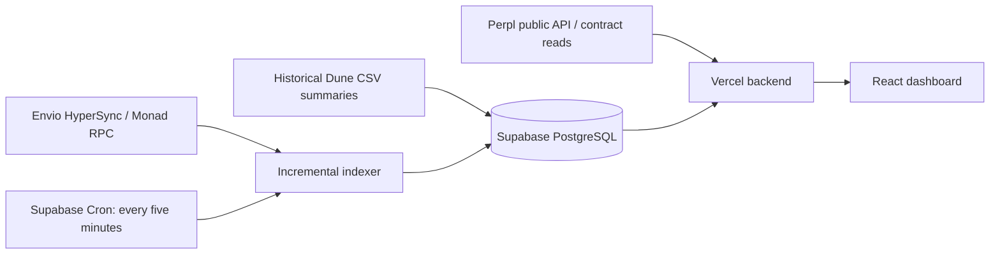

# Perpl Analytics

Protocol analytics and public wallet intelligence for Perpl on Monad.

**[Open the dashboard](https://perpl-analytics.vercel.app/)** · [Metric definitions](https://perpl-analytics.vercel.app/methodology)

## Explore

- Volume, open interest, fees, capital flows and account growth.
- Market share, funding, trader rankings and liquidation activity.
- Daily, weekly and monthly charts with optional cumulative lines and exports.
- Public wallet positions and Perpl leaderboard performance, with a browser-local watchlist.
- Light and dark themes, responsive layouts and five-minute refresh targets.

No wallet connection or user API key is required. Protocol headline metrics use fixed current, 24-hour or all-time windows; chart filters affect the selected panel and individual charts.

## Data and architecture

Historical summaries begin in February 2026. One-time Dune CSV imports supply the historical baseline; Envio HyperSync and Monad RPC extend it with incremental summaries. The running dashboard makes no Dune API queries. Perpl's public API and contract reads supply market snapshots, leaderboard totals and current wallet positions.

Provider delays can affect freshness. Unavailable metrics appear as a dash. Historical event details have different coverage from daily aggregates; wallet leaderboard PnL is distinct from estimated unrealized position PnL. Prices currently use periodic snapshots. See the metric definitions for calculations and coverage.

## Project layout

- `components/`, `hooks/`, `lib/`: interface and data presentation.
- `indexer/`: event decoding, wallet reads and incremental summaries.
- `cloud/`: PostgreSQL storage, refresh jobs and historical seed.
- `api/`, `scripts/build-web.mjs`, `vercel.json`: Vercel deployment.
- `tests/`: data integrity and API protections.

## Privacy and storage

The seed contains public blockchain aggregates and event details, without wallet-search caches. Wallet searches send the public address to the backend; watchlists and recent searches remain in browser storage. Shared wallet URLs contain the selected address. Server credentials are never needed by the browser.

Permanent historical summaries are retained. Disposable caches and recent detail windows are bounded; a 400 MiB database guard pauses indexing without advancing its checkpoint. These protections reduce resource usage but do not guarantee unlimited traffic within free hosting quotas. See [SECURITY.md](SECURITY.md) for deployment safeguards.

Perpl, Monad and Envio brand assets identify their respective services. Perpl Analytics is a community-built dashboard.
